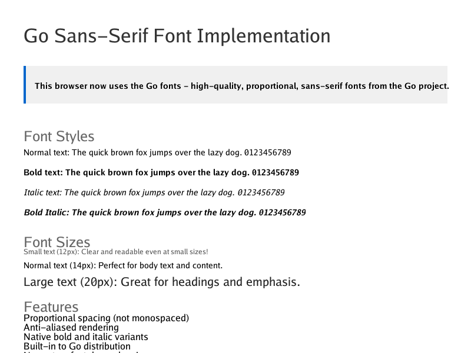
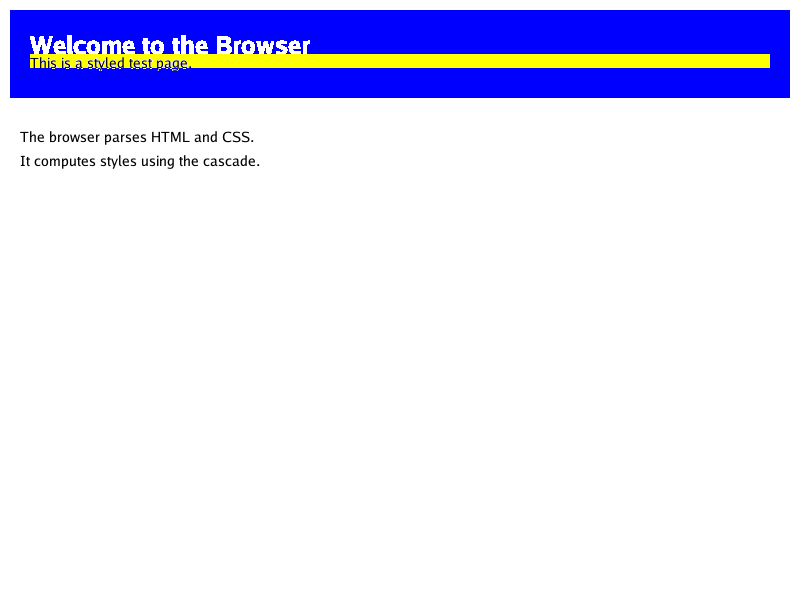
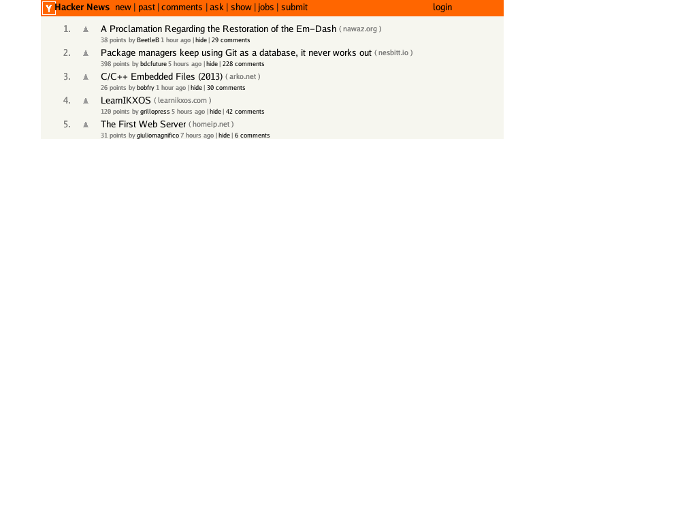

# Browser - A Simple Web Browser in Go :)

[](https://github.com/lukehoban/browser/actions/workflows/ci.yml)
[](https://goreportcard.com/report/github.com/lukehoban/browser)

A simple web browser implementation in Go, focusing on static HTML and CSS 2.1 compliance. This project aims to stay close to W3C specifications and provide a clean, well-organized codebase for educational purposes.

The command-line application reads a local HTML file or an HTTP/HTTPS page, parses HTML and CSS, computes styles and layout, and writes a PNG image or prints a tree for debugging. The WebAssembly demo exposes the rendering pipeline in a web page. Standards support is partial; see the milestones and testing documentation below for implementation gaps.

## Features

- HTML parsing with DOM tree construction
- CSS 2.1 parsing and style computation
- Visual formatting model (box model, block layout)
- **High-quality text rendering** with Go fonts (proportional sans-serif)
- Font styling support (bold, italic, underline, size)
- Image rendering (PNG, JPEG, GIF, SVG support)
- **Data URLs**: Support for RFC 2397 data URLs (base64 and URL-encoded)
- Background and border rendering
- PNG image output
- **Network support**: Load pages via HTTP/HTTPS
- **External CSS**: Fetch and apply stylesheets from `<link>` tags
- **Network images**: Load images from remote URLs
- **WebAssembly**: Run the browser entirely in a web client

## Project Structure

```
browser/
├── cmd/
│   ├── browser/      # Main CLI browser application
│   ├── browser-wasm/ # WebAssembly entry point
│   └── wptrunner/    # WPT reference test runner
├── html/            # HTML tokenization and parsing
├── css/             # CSS parsing
├── dom/             # DOM tree structure
├── style/           # Style computation and cascade
├── layout/          # Layout engine (visual formatting model)
├── render/          # Rendering engine
├── reftest/         # Reference test harness
├── wasm/            # WebAssembly demo page
└── test/            # Test files and fixtures
```

## Specifications

This browser implementation follows these W3C specifications:

- **HTML5**: Tokenization and parsing ([HTML5 §12](https://html.spec.whatwg.org/multipage/parsing.html))
- **CSS 2.1**: Syntax, selectors, cascade, box model, and visual formatting
  - [CSS 2.1 §4 Syntax](https://www.w3.org/TR/CSS21/syndata.html)
  - [CSS 2.1 §5 Selectors](https://www.w3.org/TR/CSS21/selector.html)
  - [CSS 2.1 §6 Cascade](https://www.w3.org/TR/CSS21/cascade.html)
  - [CSS 2.1 §8 Box Model](https://www.w3.org/TR/CSS21/box.html)
  - [CSS 2.1 §9 Visual Formatting Model](https://www.w3.org/TR/CSS21/visuren.html)
- **RFC 2397**: The "data" URL scheme for inline resources

## Quick Start

### Prerequisites

- Go **1.24.11 or newer**, as declared in [go.mod](go.mod).
- For the optional WebAssembly demo: a web browser with WebAssembly support and Python 3 to run the local HTTP server shown below.

### Installation and building

From a local checkout, run these commands in the repository root (the directory containing `go.mod`):

```bash
go mod download
go build ./cmd/browser
```

This installs the declared Go modules into the module cache and builds the `browser` executable in the repository root (`browser.exe` on Windows). Dependency downloads require network access unless the modules are already cached. The examples below use a POSIX shell. Go fonts are embedded in the binary, so no separate font installation is needed.

### Running

Run from the repository root so the fixture paths resolve. The default viewport is 800×600 pixels. With `-output`, the CLI saves a PNG; without it, the CLI prints the layout tree. Put options before the input file or URL.

```bash
# Render local HTML file to PNG
./browser -output output.png test/styled.html

# Load and render a web page from URL
./browser -output hn.png https://news.ycombinator.com/

# View layout tree without rendering (text output)
./browser test/styled.html

# Custom viewport size
./browser -output output.png -width 1024 -height 768 test/styled.html

# Inspect computed styles in the render tree
./browser -show-render test/styled.html
```

The local `test/styled.html` example needs no network access once dependencies are available. URL examples and remote page resources require network access.

## Development and checks

Run directly from source while developing:

```bash
go run ./cmd/browser -show-layout test/styled.html
```

Tests live alongside their packages in `*_test.go` files; HTML fixtures are in `test/`. From the repository root:

```bash
# Verify cached dependencies and compile native packages
go mod verify
go build -v ./...

# Run all tests, or focus on the package you are changing
go test ./...
go test ./html

# Run tests with coverage
go test -cover ./...

# Run the bundled WPT CSS reference tests with detailed results
go test -v ./reftest -run TestWPTCSSReftests
```

The WPT Go test allows the expected failures listed in `reftest/wpt_test.go`, but fails on unexpected failures or errors. See [TESTING.md](TESTING.md) for the standalone runner and test contribution guidance. [CI](.github/workflows/ci.yml) also runs race detection with coverage and golangci-lint.

For feature work, add tests in the affected package and appropriate HTML fixtures. Follow the [contributor guidance](.github/copilot-instructions.md): update milestones for significant changes, and include screenshots for changes affecting rendering, layout, or styling.

## Screenshots

### Font Rendering

The browser uses the [Go fonts](https://blog.golang.org/go-fonts) - high-quality, proportional, sans-serif fonts designed for the Go project. These fonts are embedded in the binary and provide excellent readability with support for bold, italic, and various sizes.



### Test Case Rendering

Example of styled HTML with borders, colors, and text formatting:



### Hacker News

Latest Hacker News render (1024x768):



## WebAssembly

The browser can be compiled to WebAssembly and run entirely in a web browser. A live demo is available at **https://lukehoban.github.io/browser/** and is automatically deployed via GitHub Actions.

To build and serve locally from the repository root:
```bash
GOOS=js GOARCH=wasm go build -o wasm/browser.wasm ./cmd/browser-wasm
cd wasm && python3 -m http.server 8080
```

Open http://localhost:8080 in your web browser. The demo loads the generated `browser.wasm` with the included `wasm_exec.js`. Enter HTML with CSS in `<style>` tags or inline style attributes, then click **Render**. It does not fetch external stylesheets or provide live-page URL loading; use the CLI for those workflows. Stop the server with Ctrl+C and return to the repository root before running the development checks.

See [wasm/README.md](wasm/README.md) for more details.

## Documentation

- **[MILESTONES.md](MILESTONES.md)** - Implementation milestones and progress tracking
- **[IMPLEMENTATION.md](IMPLEMENTATION.md)** - Detailed implementation summary and architecture
- **[TESTING.md](TESTING.md)** - Testing strategy and public test suite integration

## Current Status

✅ Milestones 1-7 Complete: Foundation, HTML Parsing, CSS Parsing, Style Computation, Layout Engine, Rendering, Image Rendering  
✅ Milestone 9 Complete: Network Support (HTTP/HTTPS, external CSS, remote images)  
✅ Milestone 9.5 Complete: Data URL Support (RFC 2397, base64 & URL-encoded inline resources)  
🔄 Milestone 8 In Progress: Testing & Validation (run the bundled WPT check above for current results)

See [MILESTONES.md](MILESTONES.md) for detailed progress and known limitations.

## License

MIT
